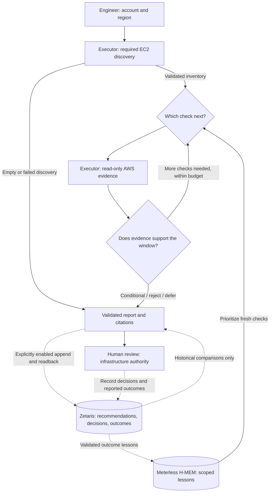

# Cloud Cost Investigator

> Built to participate in **Open Agent Hackathon 2026**.<br>
> **Track:** 02 — The Agent That Can Explain Why<br>
> **Sponsor technology:** Zetaris, Meterless H-MEM, NVIDIA Nemotron<br>
> **Run:** `npm ci`, then `npm start` for the local web UI (Demo and Live).

## 1. Problem

Infrastructure and backend engineers can see idle EC2 capacity, but low average CPU does not tell them whether an instance can safely stop. Overnight jobs, traffic peaks and dependencies can turn an attractive saving into an outage.

CCI finds **AWS EC2 off-hours scheduling opportunities** within an account and region, then challenges each proposed shutdown window with fresh evidence. It returns a **conditional recommendation**, an evidence-backed **rejection of that window**, or **needs verification**. CCI never changes infrastructure; an authorized human decides what to do (L2).

## 2. Agents and responsibilities

Required EC2 discovery runs first. Its validated result feeds one bounded planner → executor → evaluator loop. These roles are responsibilities within that engine, not separate autonomous model agents.

| Role                          | Responsibility                                                                                                         | Can block or retry?                                                 |
| ----------------------------- | ---------------------------------------------------------------------------------------------------------------------- | ------------------------------------------------------------------- |
| Planner                       | Chooses checks and proposes windows using a configured model or scripted planning.                                     | Replans from evidence; transient model failures can retry.          |
| Executor                      | Collects inventory, billing, utilization, jobs/operations and dependencies; validates scope, time, units and coverage. | Rejects invalid actions/data; retries failed reads within budgets.  |
| Safety evaluator              | Deterministic code challenges proposals and owns verdicts.                                                             | Blocks unsupported advice, rejects contradictions, defers unknowns. |
| Report validator and renderer | Checks citations, hypothesis transitions and savings; emits next human actions.                                        | Blocks inconsistent reports.                                        |

## 3. What makes this an agent system

- **Evidence changes the next action:** observations, hypotheses and prior attempts feed replanning.
- **The evaluator overturns proposals:** in Sample Scenario B, low CPU suggests 00:00–06:00 UTC; a fresh check finds a critical 02:00–03:00 job and rejects that window.
- **Recovery is bounded:** retry failures, then preserve findings and defer unresolved safety.
- **Learning changes check order:** H-MEM prioritizes risks to check against fresh evidence.
- **Decisions are inspectable:** hypotheses, citations, timestamps, source modes and retries appear in the [actual model-driven trace](docs/TRACE_EXAMPLE.md).



[Architecture and authority boundaries](docs/components.md).

## 4. Tech stack

| Component                | Technology                                                                                |
| ------------------------ | ----------------------------------------------------------------------------------------- |
| Runtime and CLI          | Node.js 24+, TypeScript                                                                   |
| Orchestration and safety | Bounded stateful loop, runtime validation, deterministic evaluator and savings calculator |
| Current evidence         | AWS SDK read-only adapters for EC2, Cost Explorer, CloudWatch, SSM and ELBv2              |
| Model planning           | OpenAI-compatible Chat Completions; NVIDIA-hosted Nemotron preset                         |
| Reusable lessons         | Vendored Meterless H-MEM reference, local disk persistence                                |
| Decision follow-through  | Zetaris HTTP adapter, dedicated history reads and explicitly authorized append/readback   |
| Presentation and traces  | CLI stdout, JSON or JSONL; loopback Node HTTP server and browser UI                       |

<details>
<summary>Sponsor technology: contribution and proof</summary>

**Zetaris — decision follow-through.** Engineers can revisit recommendations, attributed Accept/Defer decisions, due reviews and reported outcomes. Validated outcome feedback can teach H-MEM which risks to check first.

**Meterless H-MEM — learning across runs.** Stores and recalls scoped lessons so the planner can investigate a previously discovered risk first. It is reasoning memory, not the model runtime or a current telemetry source.

**NVIDIA — adaptive investigation.** NVIDIA-hosted Nemotron chooses allowlisted checks and proposes windows. Trusted code binds tool arguments; the deterministic evaluator controls verdicts.

Real model calls, H-MEM persistence and remote Zetaris append/readback have [recorded proof](docs/components.md#sponsor-technology-explanation), using **synthetic AWS evidence**. The default demo uses scripted planning. No general H-MEM speedup has been established.

</details>

## 5. Setup

Requires **Git, Node.js 24+**. The offline investigation demo needs no GPU, credentials, `.env` or external services. H-MEM is already vendored; do not run `npm run setup`, which refreshes it from upstream.

```bash
git clone https://github.com/milaforge/cloud-cost-investigator.git
cd cloud-cost-investigator
npm ci
npm start
```

Choose **Demo**, select a scenario and see the investigation result. Open the printed loopback URL if the browser does not open. Stop with Ctrl+C; use `npm start -- --no-open` on a headless machine.

For service-dependent features, copy `.env.example` to `.env` **only if absent**; otherwise merge settings. Never commit credentials. Shell variables take precedence. Configure only what you need:

- [AWS credentials, scope and data prerequisites](docs/AWS_SETUP.md) for live evidence.
- [Chat Completions provider/model configuration](docs/CLI_GUIDE.md#model-configuration) for real inference, which may incur usage.
- [Persistent H-MEM](docs/MEMORY.md#configuration) for lessons across CLI runs.
- [Zetaris installation and app connection](docs/ZETARIS_SETUP.md) for durable decision history. Retained writes require explicit authorization and append configuration.

[Full setup and clean-checkout procedure](docs/HOW.md).

## 6. Usage

First run: synthetic evidence and scripted planning. Command-local settings disable configured historical stores:

```bash
ZETARIS_HISTORY_TABLE= HMEM_PERSIST_DIR= ZETARIS_HISTORY_ALLOW_APPEND=false npm run --silent investigate -- --evidence mock --planner scripted --account demo --region us-east-1 --scenario B
```

Actual output, abridged:

```text
NOT RECOMMENDED — i-mock-primary
Window: 00:00–06:00 UTC daily
Why: A retrieved critical job overlaps the proposed shutdown window; reject this window.
Evidence: get_ec2_operations (ok)
Next: Keep the proposed window rejected; review the cited conflict with the resource owner.
Savings: unknown
Mode: MOCK (synthetic data; no AWS calls); planner: scripted
Read-only. Any infrastructure change requires human review and approval.
```

Add **one** flag: `--verbose` for full evidence/trace, `--json` for the report, or `--trace-jsonl` for decision events. Redirect stdout to save output; JSONL emits after finalization. Reports include citations, missing checks, human actions and qualified savings or `null`. [CLI reference](docs/CLI_GUIDE.md).

For live, read-only AWS evidence, configure the intended identity first and replace the account placeholder:

```bash
npm run --silent investigate -- --account YOUR_12_DIGIT_ACCOUNT_ID --region us-east-1
```

**Live AWS is the CLI default.** The account argument verifies scope; it does not supply credentials. Planning defaults to scripted; add `--planner model` for your configured provider or `--planner nvidia` for the NVIDIA preset. Neither evidence nor model failures switch to demo results.

## 7. Sample mode and verification

`--evidence mock` selects [synthetic input observations](src/investigation/mock.ts). The engine computes reports at runtime; no stored final answers are returned.

| Scenario                          | What it demonstrates                                 | Expected result / exit                                    |
| --------------------------------- | ---------------------------------------------------- | --------------------------------------------------------- |
| `A`                               | Explicit synthetic operational clearance and pricing | `conditional_recommendation` / 0; human approval required |
| `B`                               | A critical job contradicts the initial window        | `not_recommended` / 0                                     |
| `C`                               | A dependency requires continuous operation           | `not_recommended` / 0                                     |
| `missing`                         | Critical authority is unavailable                    | `needs_verification`, partial / 2                         |
| `mixed` with `--max-candidates 3` | Three ranked candidates with different outcomes      | Per-candidate verdicts / 0                                |

The browser also provides **Learn** for cold/warm/changed-evidence runs with real temporary local H-MEM. **Follow through** requires configured Zetaris and explicit acknowledgment before retaining synthetic decision records. [Browser workflows](docs/HOW.md#open-the-web-demo).

```bash
npm test
npm run typecheck
npm run lint
npm run format:check
```

These checks use local fixtures and exclude paid live integration tests. [Evaluation and recorded measurements](docs/evaluation/README.md) distinguish policy tests, actual model calls and sponsor persistence.

## 8. Failure handling

| Failure                                        | Behavior                                                                                                                                                                                |
| ---------------------------------------------- | --------------------------------------------------------------------------------------------------------------------------------------------------------------------------------------- |
| Required inventory or billing fails            | Retry the same read up to three times after the initial attempt within budgets; then stop with a named failure and exit 1. Invalid scoped data is terminal. Inventory precedes billing. |
| Authenticated empty inventory                  | Successful no-candidate result; no billing query needed.                                                                                                                                |
| Missing, partial or empty operational evidence | Preserve status and defer unknown safety. Failed reads have bounded retries; empty results cannot establish clearance.                                                                  |
| Unsupported recommendation                     | Deterministic evaluator blocks it; retrieved contradictions reject the evaluated window.                                                                                                |
| Model unavailable                              | Up to three attempts per decision for transient failures, within budgets. Permanent errors, malformed output and cancellation are terminal. No scripted fallback.                       |
| Runtime/call budget exhausted                  | Preserve completed findings and defer unresolved candidates. Live planning shares a 15-minute total budget, 60-second model-call cap and finalization reserve.                          |
| History read/write fails                       | Disclose separately; history cannot replace current evidence. Never automatically retry an uncertain append.                                                                            |
| Invalid CLI input                              | Exit 1 with a validation message before investigation.                                                                                                                                  |

Exit **0** means a completed scoped investigation, including a rejection or no candidates; **2** means partial; **1** means failure or invalid invocation. [Exact retry and deadline policy](docs/CLI_GUIDE.md#failure-behavior).

## 9. Data and licensing

Bundled scenarios and demo records are labeled synthetic. Live reports contain account/resource identifiers and operational details; keep them out of public artifacts. Credentials remain server-side.

The project [`package.json`](package.json) declares **Apache-2.0**. The vendored H-MEM reference also declares Apache-2.0 and retains its [upstream documentation and attribution](vendor/hmem/README.md).

## 10. Limitations

- AWS EC2 scheduling only, at most three candidates; daily same-day UTC windows. No resizing, multi-cloud or automated remediation.
- Live positive scheduling proof remains limited by metric history, billing and authoritative operational coverage. Native SSM/ELBv2 reads do not establish all jobs, dependencies or owner clearance.
- Low CPU, a `dev` tag or an empty query cannot establish safety. Unsupported pricing, commitment or retained-resource assumptions keep savings `null`.
- Historical decisions and H-MEM lessons are not current facts. Sponsor integrations with synthetic evidence do not prove live AWS safety or realized savings.

[Current verification status and remaining release gates](docs/EXECUTION_PLAN.md) are tracked separately from product capabilities.

## 11. Pre-existing components

CCI extends the TypeScript notebook starter and [Meterless H-MEM reference](vendor/hmem/README.md), including its hash embedder and JSON persistence. The optional notebook is not invoked by the demo.

Project-specific extensions include the CLI, evidence adapters, bounded loop, safety policy, report validation and follow-through. Exact build-window attribution requires Git-history review; [Reuse and development details](docs/components.md#reused-components).
