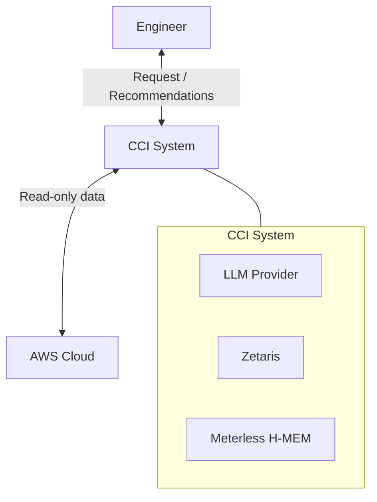
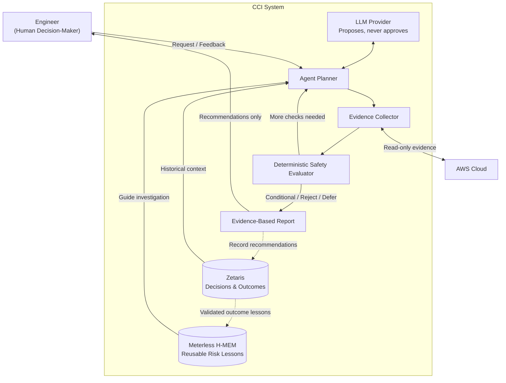
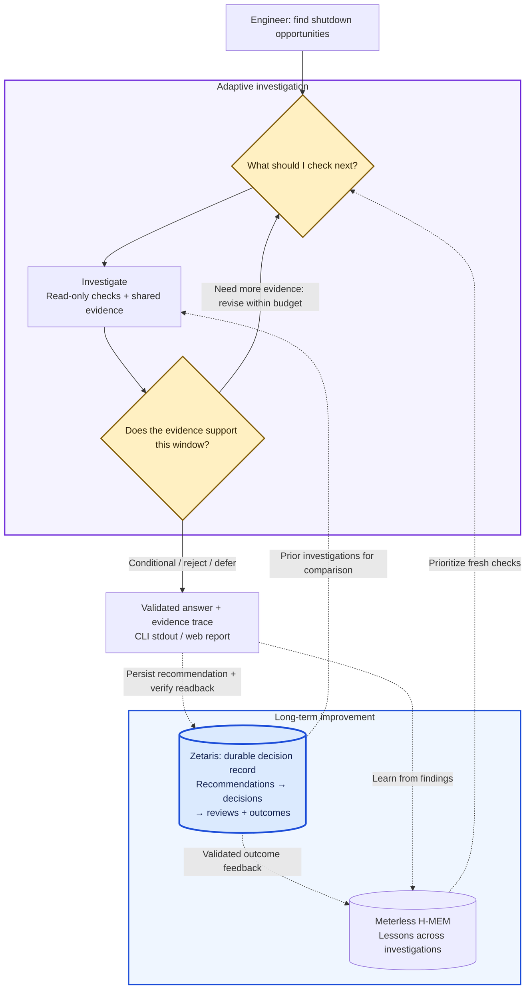

# Cloud Cost Investigator

> Built to participate in **Open Agent Hackathon 2026**.

**Track**: The Agent That Can Explain Why

**Project**: CCI

**User**: Infrastructure & Backend Engineers

**Goal**: Evaluate cloud usage and recommend opportunities to reduce costs. For this hackathon, start with AWS EC2 off-hours scheduling.

CCI challenges potential shutdown windows using operational evidence, then conditionally recommends a window, advises against it, or requests further verification. It's is read-only; every infrastructure change remains a human decision.

Current five evidence categories:

- instance inventory
- billing
- utilization
- job schedules
- and dependencies.

<details>
<summary>Sponsor Technology</summary>

**Zetaris (decision follow-through).** Enables revisiting a recommendation,
seeing who accepted or deferred it, and tracking its review and reported outcome.
Zetaris preserves that trail across investigations.

**Meterless H-MEM (learning across runs).** A later investigation can check a
previously discovered risk first, such as an overnight batch job. H-MEM recalls
scoped lessons so the planner can prioritize those checks using fresh evidence.

**NVIDIA (adaptive investigation).** The investigation can change its next check
as evidence arrives. NVIDIA-hosted Nemotron selects checks and proposes shutdown
windows; a deterministic evaluator rejects contradictions and defers unknowns.

**What is unique.** An engineer's reported outcome can improve the next
investigation: validated Zetaris feedback teaches H-MEM which risks to check
first. Every recommendation still requires fresh AWS evidence and human review.

[Integration details and recorded proof](docs/components.md#sponsor-technology-explanation).
Sponsor receipts use synthetic AWS evidence; the default demo uses scripted planning.

</details>

## Components - 1



### Components - 2



<details>
<summary>
Agentic Overview — At a Glance

</summary>



**Zetaris anchors long-term improvement:** it connects recommendations to
operator decisions, due reviews and reported outcomes. Validated outcome feedback
teaches H-MEM which risks to investigate first on future runs.

Diamonds mark decisions; the return arrow shows replanning. Dotted arrows show
history and learning across runs. Failures preserve findings and defer unknowns;
sample evidence requires explicit selection. The execution detail follows below.

</details>

<details>
<summary>
The Why
</summary>

Low average CPU can hide a weekly batch job or a service that needs continuous uptime. A cost-saving suggestion is useful only if an engineer can understand the operational reasons it could fail.

CCI challenges each proposed shutdown window. In the main demo, apparently idle overnight capacity looks promising until a fresh check finds a critical batch job in that window. The agent rejects the schedule and cites the contradiction. When critical evidence is missing, it defers the decision.

The goal is to help infrastructure engineers decide which opportunities deserve human review, which should be rejected, and which need more evidence.

</details>

<details>
<summary>
The How
</summary>

[Runtime details](docs/components.md) · [Trace capture](docs/CLI_GUIDE.md#capture-and-read-the-decision-trace). [How](docs/HOW.md)

</details>

### Setup

<details>
<summary>
Dependencies
</summary>

- Node.js 24+
- npm
- and Git.
- Meterless H-MEM is vendored.
- OpenAI compatible model provider
- Zetaris
- AWS access

> DEMO needs no GPU, credentials or external services;

</details>

<details>
<summary>
Setup
</summary>

```sh
git clone --depth 1 https://github.com/milaforge/cloud-cost-investigator

cd cloud-cost-investigator

npm ci
```

For persistent history and follow-through, complete [Zetaris setup](docs/ZETARIS_SETUP.md):
installation, storage provisioning and app connection.

</details>

## DEMO

```sh
git clone --depth 1 https://github.com/milaforge/cloud-cost-investigator

cd cloud-cost-investigator

npm ci

npm run demo:web
```

- It starts a local server and opens your browser;
  - if opening fails, use the printed URL.
- Stop with Ctrl+C.

- run scenarios A/B in **Investigate**, then try **Learn**.

- **Follow through** requires configured Zetaris and explicit consent to retain demo history;

- real-service controls are opt-in.
- Load existing JSON reports or inspect evidence in the UI.

See [example traces](./docs/TRACE_EXAMPLE.md).
