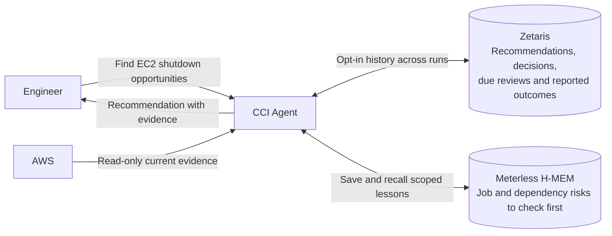
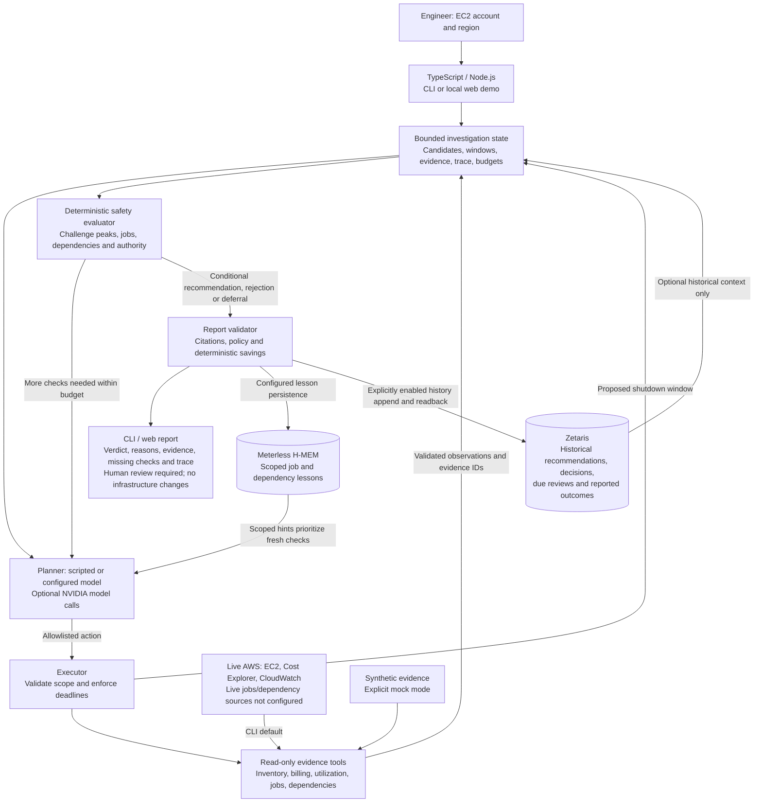

# Cloud Cost Investigator

> Built to participate in **Open Agent Hackathon 2026**.

**Track**: The Agent That Can Explain Why

**Project**: CCI

**User**: Infrastructure & Backend Engineers

**Goal**: Answer "safe AWS EC2 shutdown windows to reduce monthly cloud costs".

It combines five evidence categories:

- instance inventory
- billing
- utilization
- job schedules
- and dependencies.

## Abstract Overview



<details>

<summary>
Detailed Overview
</summary>



</details>

<details>
<summary>
Dependencies
</summary>

- Node.js 24+
- npm
- and Git.
- Meterless H-MEM is vendored.
- OpenAI compatible model provider
- Zetaris
- AWS access

> DEMO needs no GPU, credentials or external services;

</details>

<details>
<summary>
Setup
</summary>

```sh
git clone --depth 1 https://github.com/milaforge/cloud-cost-investigator

cd cloud-cost-investigator

npm ci
```

</details>

<details>
<summary>
DEMO
</summary>

```sh
npm run demo:web
```

- It starts a local server and opens your browser;
  - if opening fails, use the printed URL.
- Stop with Ctrl+C.

- run scenarios A/B in **Investigate**, then try **Learn**.

- **Follow through** requires configured Zetaris and explicit consent to retain demo history;

- real-service controls are opt-in.
- Load existing JSON reports or inspect evidence in the UI.

</details>

<details>
<summary>
The Why
</summary>

Low average CPU can hide a weekly batch job or a service that needs continuous uptime. A cost-saving suggestion is useful only if an engineer can understand the operational reasons it could fail.

CCI challenges each proposed shutdown window. In the main demo, apparently idle overnight capacity looks promising until a fresh check finds a critical batch job in that window. The agent rejects the schedule and cites the contradiction. When critical evidence is missing, it defers the decision.

The goal is to help infrastructure engineers decide which opportunities deserve human review, which should be rejected, and which need more evidence.

</details>

<details>
<summary>
The How
</summary>

[How](docs/HOW.md)

</details>
