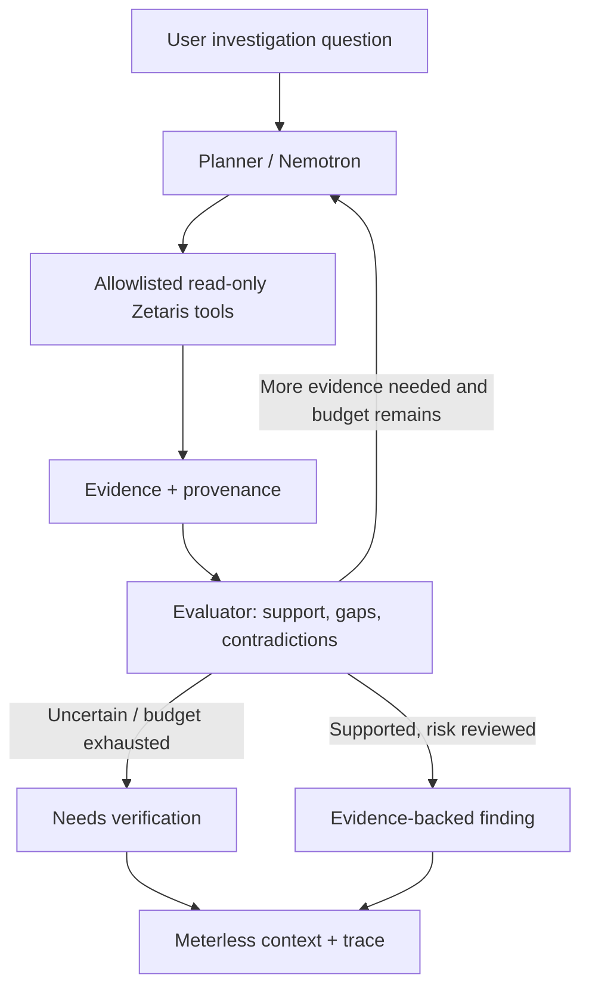

# Cloud Cost Investigator — Project Context

> Source of truth for coding agents and contributors. Read this before making architecture or product changes. See [`EXECUTION_PLAN.md`](./EXECUTION_PLAN.md) for ownership, milestones, and acceptance checks.

**Status:** Day 2 kickoff (2026-10-23); starter code inspected, runtime integrations not verified in this review.  
**Hackathon:** Open Agent Hackathon 2026  
**Chosen track:** **Track 02 — The Agent That Can Explain Why**  
**Submission deadline:** **2026-10-27 23:45 UTC** (as stated in event planning material; recheck submission portal).  
**Team:** Milad (agent/reasoning/integration) and Zayan (data/Zetaris).  
**Primary target:** AWS EC2 only.

## Document alignment

Read [`RULES.md`](./RULES.md) for recorded event requirements and the full rubric,
[`EXECUTION_PLAN.md`](./EXECUTION_PLAN.md) for milestones and verification evidence,
and [`../AGENTS.md`](../AGENTS.md) for contributor workflow. Event examples do not
expand the agreed EC2 scope or require multiple autonomous agents. Resolve event
updates against the submission portal; these local notes are not live verification.

## 1. Product in one paragraph

**Cloud Cost Investigator** is a read-only, evidence-driven AI agent for small engineering teams that investigates **why AWS EC2 spending increased** and whether suggested reductions are **operationally safe**. It correlates billing, CloudWatch utilization, resource inventory, and operational changes; forms hypotheses; retrieves missing evidence; challenges its own suggestions; and delivers a prioritized report showing causes, *potential* savings, risks, assumptions, evidence, and next checks. **The product's distinguishing feature is knowing when *not* to optimize.** It must never treat low CPU usage alone as proof a server can be safely stopped or downsized.

## 2. User, problem, and outcome

- **User:** An engineer or small infrastructure/platform team operating AWS EC2.
- **Problem:** Billing data, CloudWatch metrics, EC2 configuration/tags, and deployment/scheduling history are fragmented. A resource can look wasteful but be necessary for overnight jobs, peak loads, availability, or future capacity.
- **Questions to answer:**
  1. Why did EC2 costs increase over a defined period?
  2. Which increases appear justified versus potentially avoidable?
  3. What change could reduce costs, what evidence supports it, and what must be verified before action?
- **Outcome:** A **traceable, decision-ready investigation report**, not an infrastructure modification.

## 3. Hackathon judging priorities

Recorded rubric: **Impact 30, Technical 20, Innovation 15, Demo 15,
Product & UX 10, Sponsor Tech 10** (100 points total; see `RULES.md`). Starter
material describing a different rubric does not override these event notes.

| Criterion | How this MVP demonstrates it |
| --- | --- |
| Technical execution | End-to-end working planner → data tools → evaluator → report; bounded loops and typed outputs |
| Real-world impact | Evidence-backed EC2 savings opportunities, including justified *do not change* decisions |
| Innovation | Contradiction-aware, risk-aware investigation rather than utilization-threshold suggestions |
| Demo quality | Show the same investigation evolving as new or conflicting evidence arrives; display decision trace |
| Use of technology | **Zetaris**, **Meterless**, **Cursor**, and **NVIDIA technology** where it materially contributes |

**Strong agent behavior:** adaptive tool choice, evaluator-driven re-planning, branching, retries, persistent state, and visible evidence/decision traces. **Weak behavior to avoid:** a fixed sequential pipeline, multiple superficial LLM prompt personas, or an ungrounded summary dressed up as an investigation.

## 4. Scope contract

### Must ship (P0)

- **AWS EC2 only**; one account/region or a small synthetic equivalent is enough for the demo.
- Read billing records, utilization metrics, and resource inventory **through a working Zetaris integration**. Include operational change/schedule evidence for the safety demonstration.
- Call an allowed model via the hackathon-approved integration (prefer **NVIDIA Nemotron**, when access is verified).
- Demonstrate a basic **planner → executor → evaluator → replan/finish** loop.
- Persist/retrieve useful investigation context via **Meterless**; identify what is historical memory vs fresh evidence.
- Produce a structured report containing findings, evidence references, risk/uncertainty, missing checks, and *qualified* potential savings.
- Never directly modify cloud infrastructure.

### Required demonstration and evaluation (P0)

- Challenge the initial cost-saving hypothesis with counter-evidence before recommending changes.
- An explicit decision trace: queries, observations, rejected hypotheses, remaining unknowns, final conclusion.
- A reproducible three-scenario evaluation and comparison with a simple rule-based baseline.

### Optional presentation enhancement (P1)

- A lightweight UI or trace viewer for the 1–4 minute demo. A working CLI and
  readable trace satisfy the surface requirement; the demo itself is required.

### Out of scope for the hackathon (P2 / later)

- Multi-cloud (Azure/GCP); Kubernetes; exhaustive AWS service coverage.
- Automated stopping, resizing, purchasing commitments, changing auto-scaling, or other infrastructure writes.
- Enterprise onboarding, production-ready IAM setup wizard, complete FinOps dashboards, advanced forecasting.
- Large multi-agent frameworks or many autonomous roles without a demonstrable advantage.

## 5. Demonstration scenarios (use deterministic, labeled fixture data if live AWS data is unavailable)

| Scenario | Setup | Required conclusion |
| --- | --- | --- |
| **A — Avoidable off-hours compute** | Development EC2 runs 24/7; low off-hours use; known environment and owner; schedules/dependencies checked as far as possible | Propose a **conditional** stop schedule, estimate *compute-only* avoidable cost, state approval and outstanding checks |
| **B — Unsafe-looking optimization** | Production EC2 looks idle on average but has a weekly load spike, necessary scheduled job, or critical dependency | **Reject or defer** an initial stop/downsize hypothesis, cite the contradicting evidence, explain risk |
| **C — Legitimate spend increase** | Higher EC2 spend correlates with increased real workload or an intentional capacity change | Explain the increase without labeling it waste; possibly recommend monitoring only |

**The demo centerpiece is B:** the agent initially considers an optimization and then retracts it after querying conflicting evidence. Never fake a claimed autonomous replan by scripting a static narrative. Synthetic test data is acceptable when labeled as synthetic.

## 6. Minimum data contract

Use consistent IDs, AWS account/region, UTC timestamps, collection windows, units, and provenance. Missing fields are **unknown**, not zero.

| Logical dataset | Minimum fields | Notes |
| --- | --- | --- |
| `ec2_billing` | `account_id`, `region`, `instance_id` (if available), `timestamp/date`, `cost`, `currency`, `usage_type`, `pricing_model` | Do not assume every charge is attributable to a single instance. Prefer measured cost over guessed on-demand pricing. |
| `ec2_metrics` | `account_id`, `region`, `instance_id`, `timestamp`, `cpu_percent`, `network_in_bytes`, `network_out_bytes`, optional `memory_percent` | Capture coverage, aggregation granularity, and peak statistics. CloudWatch memory is generally not a default EC2 metric. |
| `ec2_inventory` | `account_id`, `region`, `instance_id`, `instance_type`, `state`, `environment`, `owner`, `tags` | Include enough metadata to distinguish dev/prod and to relate other datasets. |
| `ec2_changes` | `account_id`, `region`, `instance_id`, `timestamp`, `change_type`, `description`, optional `job_or_schedule`, `source` | Deployment events, scaling/config changes, cron or scheduled workloads. This source is particularly valuable for scenario B. |

**Integration boundary:** Zetaris is the federated read/query layer. Milad's agent must call a small allowlisted tool surface implemented against it, not arbitrary model-authored SQL over unrestricted data.

Proposed tool names and return requirements (names can change by agreement, semantics should not):

- `get_cost_change(period_a, period_b, filter)` → totals, deltas, breakdown, billing coverage, evidence IDs.
- `get_instance_metrics(instance_id, window)` → time series or summaries with peaks, coverage, evidence IDs.
- `get_instance_inventory(instance_id)` → configuration, tags, owner, evidence IDs.
- `get_instance_changes(instance_id, window)` → deployment and schedule records, evidence IDs.

Every tool returns a machine-readable result with `status` (`ok`, `no_match`, `partial`, `unavailable`, `error`), `source`, `observed_at` or period, and `evidence_ids`. `no_match` means a successful query returned no matching records; it does not prove the absence of dependencies. An absent source must not be silently interpreted as "no dependencies". Validate these results at runtime, not only with compile-time interfaces.

## 7. Agent architecture and decision rules



**A single orchestrator is sufficient.** "Agentic" refers to meaningful branching and tool selection, not the number of model personas.

Minimal state:

- `investigation_id`, `question`, comparison periods, instance scope.
- Hypotheses with statuses: `proposed`, `supported`, `contradicted`, `unresolved`.
- Actions taken, query parameters, tool status, observed evidence IDs and source times.
- Evidence gaps, safety warnings, current plan, bounded step/timeout budget.
- Final report and past context saved to Meterless.

Loop:

1. Planner chooses the **next question/tool** based on current evidence and uncertainty.
2. Executor calls an allowed **read-only** tool; records result or failure.
3. Evaluator checks support, cross-source consistency, freshness, and proposed safety checks.
4. On contradiction or critical missing data, planner changes course; on budget exhaustion, report `needs_verification` rather than fabricating an answer.
5. Return an evidence-backed result and a trace of how the conclusion changed.

### Safety and trust constraints

- **Read-only AWS and Zetaris permissions**, secrets via environment/secret manager; no keys in source, logs, screenshots or fixtures.
- Cap model calls, tool calls, total runtime, query sizes, and retries. Define deterministic stop/failure statuses.
- **Model never computes monetary savings unaudited.** Use deterministic code with explicitly stated assumptions, duration, pricing/discount coverage, and units.
- EC2 stopping may avoid instance compute charges while **EBS and other retained resources may continue to cost money**. Savings Plans/Reserved Instances and other commitments may reduce or eliminate marginal bill savings.
- Low average CPU is insufficient for downsizing; consider peaks, memory, network, latency, availability, jobs and dependencies. If data is missing, state it.
- Tags (`dev`, `prod`) are clues, not proofs. Scheduled jobs not found in one table do not prove no such jobs exist.
- Persistent memory helps avoid repeated investigation; it is **not fresh telemetry** and must carry timestamps/provenance.
- Report no actionable "safe to optimize" verdict without justified checks; **human approval is mandatory** for any later remediation.
- No unexplained model-generated confidence percentages; use evidence-oriented categories (`supported`, `plausible`, `needs_verification`, `not_recommended`).

## 8. Structured report contract

Implement strict runtime-validated schemas; TypeScript interfaces alone are insufficient. Suggested shape:

```json
{
  "investigation_id": "example-id",
  "question": "Why did EC2 costs increase?",
  "scope": {"account_id": "demo", "region": "us-east-1", "from": "...", "to": "..."},
  "findings": [
    {
      "instance_id": "i-demo-001",
      "cost_driver": "Continuous dev-instance runtime",
      "recommendation": "Consider off-hours shutdown after checks",
      "estimated_monthly_savings": null,
      "currency": "USD",
      "status": "needs_verification",
      "evidence_ids": ["bill-12", "metric-07", "inventory-03"],
      "risks": ["Unverified overnight jobs"],
      "missing_checks": ["Confirm owner and required schedules"],
      "assumptions": []
    }
  ],
  "rejected_hypotheses": [],
  "investigation_trace": []
}
```

`estimated_monthly_savings` must remain null when the estimate cannot be defensibly computed. Add types/fields only when needed; preserve provenance.

## 9. Acceptance tests and evidence of real impact

At minimum, benchmark the three scenarios above and inspect the full traces. Measure:

- **Correct disposition:** saving opportunity, unsafe/defer, justified spend.
- **Evidence-reference validity:** every factual finding cites records actually returned by a tool.
- **Hypothesis revision:** can the investigator overturn a plausible but wrong first hypothesis?
- **Safety false positives:** how often does it recommend a risky change?
- **Tool failure handling:** timeout/partial/unavailable sources produce uncertainty, not false certainty.
- **Latency, tool-call count, and cost** for one reproducible run.

Compare to a simple baseline such as "flag EC2 when average CPU < X%". Clearly distinguish **measured results** from illustrative metrics; never invent a cost-saving or accuracy result.

## 10. Technology contract and verification status

- **Zetaris:** required for real data querying. Validate actual endpoint/interface, credentials, data connectors and whether each query succeeds before assuming federation works.
- **Meterless:** required for real integration; intended for durable/shared agent context. Validate actual SDK/API and persist/retrieve calls. A template/starter's existence does **not** prove full agent orchestration or model access.
- **NVIDIA Nemotron:** preferred reasoning model if it contributes and access is available. Verify endpoint, quotas, auth, and tool/structured-output behavior. Do not invent SDK methods or hostnames.
- **Cursor:** use for project development and document its usage in the submission.
- **Implementation baseline:** reuse the existing TypeScript/Node.js CLI and Meterless H-MEM starter. Extend the current modules with runtime-validated contracts and a bounded investigation loop. Do not migrate to Python, add a service/database, or introduce a framework merely to match an earlier planning preference; require a concrete need and team agreement. Use a minimal trace UI only if the working CLI and required evaluations are complete.

**Unverified at document creation:** actual Zetaris account/connectors, Meterless access/SDK behavior, Nemotron inference endpoint, AWS billing availability, whether an AWS account is supplied, current implementation progress, and final submission-portal mechanics. Verify, don't assume.

## 11. Engineering guidance for coding agents

1. Read `RULES.md`, this file, `EXECUTION_PLAN.md`, and `../AGENTS.md` before implementing; do not broaden scope without explicit team approval.
2. Implement the smallest end-to-end vertical slice before a UI or extra agents.
3. Prefer deterministic parsing, joins, calculations, thresholds and safety gates; reserve the LLM for ambiguous interpretation, planning and evidence synthesis.
4. Define/validate typed interfaces and reproducible fixtures before integrating independent workstreams.
5. Support both `fixture` and `live` evidence providers with identical schemas. Label fixture data in UI and results.
6. Test all three scenarios, including a **rejected initial hypothesis** and a **missing-data** path.
7. Keep a runnable README with setup, required env vars (names only), demo commands, architecture, tests, dataset provenance, and limitations.
8. Never claim sponsor integrations, autonomous replanning, production readiness, or savings figures without executable evidence.
9. Record changes in concise commits; maintain the scope, decisions, and open integration issues in the repo.

## 12. Reference links

- Hackathon overview / event details: https://academy.genai.works/courses/open-agent-hackathon-2026/details
- AWS EC2 / Cost Explorer / CloudWatch documentation should be consulted when integrating actual AWS data.
- This document synthesizes the team's October 22 discussion and subsequent hackathon planning; the **team's scope choice (AWS EC2 only)** is agreed, while technical integration specifics remain to be verified.
