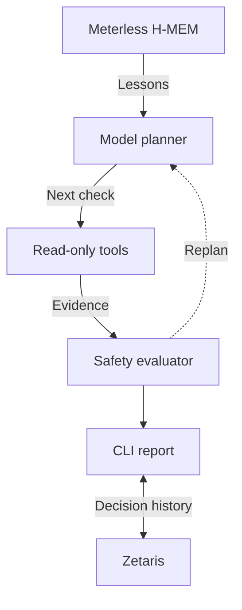

# Components at a glance

**Find EC2 scheduling opportunities. Challenge them with evidence. Explain the decision.**

A TypeScript / Node.js CLI connects the components below.

| Component | Why it matters |
| --- | --- |
| **Model planner · NVIDIA supported** | Chooses the next investigation check as evidence arrives. |
| **Read-only tools** | Collect inventory, cost, utilization, jobs and dependencies to challenge a shutdown window. |
| **Safety evaluator** | Applies deterministic rules; rejects unsafe windows and defers when evidence is missing. |
| **Meterless H-MEM** | Remembers scoped investigation lessons to prioritize fresh checks. |
| **Zetaris** | Retains recommendations, operator decisions, due reviews and reported outcomes. |
| **CLI report** | Shows the conclusion, evidence citations and decision trace for human review. |

**Verified:** real NVIDIA calls, local H-MEM persistence and remote Zetaris read/write.
**Current boundary:** operational evidence is mocked; default planning is scripted.
No infrastructure is changed. Reported outcomes are not verified savings.

**Measured value:** H-MEM saves a check in the recurring-blocker demo, but ties
fixed ordering across eight varied workloads. Zetaris proves both deferred-review
and accepted-outcome follow-through. [Results and demos](CLI_GUIDE.md#memory-and-decision-follow-through).

## Best Meterless fit

**Extend reusable investigation methods through the existing H-MEM boundary.**
Today, `memory.ts` stores two typed operational lessons; `history.ts` recalls
scoped hints; the planner orders fresh checks; the runner and deterministic
policy validate evidence and decide the verdict. Zetaris separately owns the
operator decision trail and follow-through. This already implements the useful
core of the earlier memory recommendation.

The eight-workload comparison ties both fixed orders, including cases where a
remembered blocker changes. It supports keeping the mechanism, not claiming a
general speedup or adding richer memory without evidence. Next, evaluate any
proposed reusable method against the same fixed baselines, counting teaching
cost, completion, correctness and tool/model calls. Promote a method only after
it shows a repeatable benefit without weakening fresh safety checks.

| Earlier recommendation | Fit with this implementation |
| --- | --- |
| H-MEM and reusable methods | Best architectural fit; extend typed lessons only after measured benefit |
| Nightshift-style evaluation | Useful way to discover failure cases; extend `evaluate-memory.ts` before introducing a runtime or new agents |
| World Model | Defer until real dependency evidence needs relationships beyond the existing contracts |
| Markovian compression | Defer; current bounded scope has at most three candidates and capped planner calls |
| Local Meterless runtime | Optional provider experiment; protocol, model approval and behavior need separate verification |

**Immediate product priority:** replace mocked operational sources with validated
read-only integrations. Additional engines cannot supply missing jobs or dependency
evidence. The long-term product is a cost optimization specialist agent; EC2
scheduling is the first niche. Broader optimization capabilities remain future
scope, with their own evidence contracts and safety policies.
