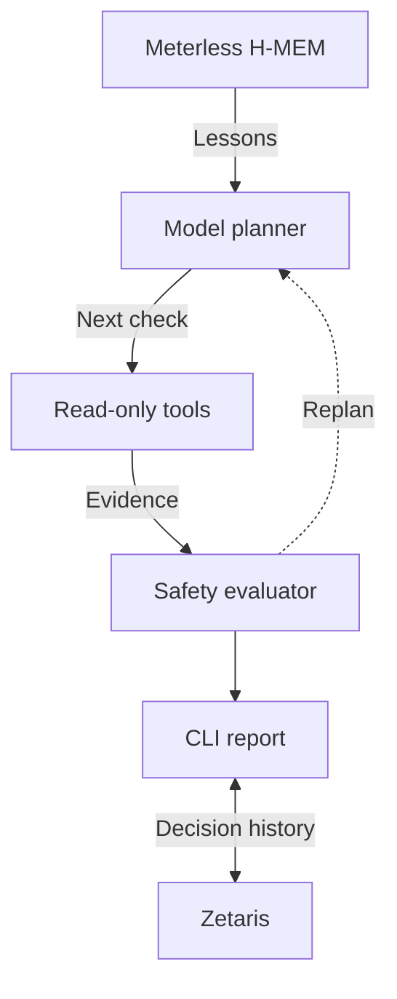

# Components at a glance

**Find EC2 scheduling opportunities. Challenge them with evidence. Explain the decision.**

A TypeScript / Node.js CLI connects the components below.

| Component | Why it matters |
| --- | --- |
| **Model planner · NVIDIA supported** | Chooses the next investigation check as evidence arrives. |
| **Read-only tools** | Collect inventory, cost, utilization, jobs and dependencies to challenge a shutdown window. |
| **Safety evaluator** | Applies deterministic rules; rejects unsafe windows and defers when evidence is missing. |
| **Meterless H-MEM** | Remembers scoped investigation lessons to prioritize fresh checks. |
| **Zetaris** | Retains recommendations, operator decisions, due reviews and reported outcomes. |
| **CLI report** | Shows the conclusion, evidence citations and decision trace for human review. |

**Verified:** real NVIDIA calls, local H-MEM persistence and remote Zetaris read/write.
**Current boundary:** operational evidence is mocked; default planning is scripted.
No infrastructure is changed. Reported outcomes are not verified savings.

**Measured value:** H-MEM saves a check in the recurring-blocker demo, but ties
fixed ordering across eight varied workloads. Zetaris proves both deferred-review
and accepted-outcome follow-through. [Results and demos](../README.md#memory-and-decision-follow-through).
