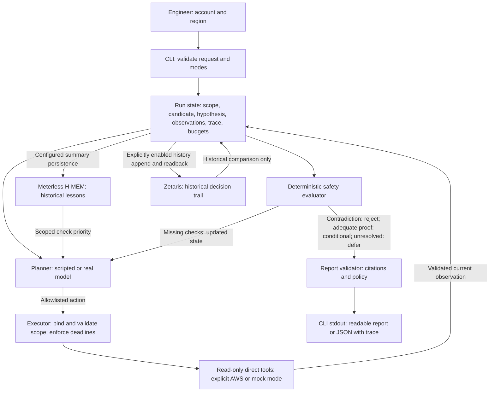

# Architecture

[What](../README.md) · [Why](WHY.md) · [How](HOW.md)

One bounded planner → executor → evaluator loop drives the TypeScript/Node.js CLI. Fresh evidence controls the decision; history informs the investigation.

| Role | Responsibility and authority | Feedback visible to judges |
| --- | --- | --- |
| **Planner** | Chooses the next check or proposes a window. The optional real model cannot authorize a verdict or modify infrastructure; the default scripted planner exercises the same engine offline. | Receives candidate-scoped observations, current hypothesis, prior attempts and scoped lesson hints on each turn. |
| **Executor** | Owns validated tool execution and current-evidence registration. Invalid scope, malformed observations and exhausted budgets cannot become usable facts. | Tool action, status and evidence IDs enter shared run state before the next decision. |
| **Safety evaluator** | Trusted deterministic code can block a positive recommendation, reject a contradicted window, or defer unknown safety. It is not another model agent. | Requires targeted checks after a proposal; remaining gaps feed the next planner turn. B ends when fresh evidence disproves the proposal. |
| **Report validator and renderer** | Revalidates citations, chronological hypotheses, positive safety proof and savings before emitting human-readable or JSON output. | Shows the proposed → supported/contradicted/unresolved transition, limitations and next human actions. |

The runner owns shared state; roles do not exchange unrestricted messages. A later planner turn sees validated observations and attempt history, so its next check depends on what happened. This supports critique, shared state, branching and evaluator authority within one loop. It does not claim several autonomous model agents. Trace capture and a real scripted B excerpt are in the [CLI walkthrough](CLI_GUIDE.md#capture-and-read-the-decision-trace); bounds and failure policy are below and in the [CLI failure reference](CLI_GUIDE.md#failure-behavior).

## Local report viewer

`scripts/demo-web.ts` owns the dependency-free local HTTP surface and initial
synthetic A/B previews. `src/web/` presents the report and runs three guided
workflows. Setup and interactions live in [How](HOW.md#open-the-web-demo).

`scripts/demo-web-jobs.ts` validates the allowlisted action, mode, scope and
explicit service/write choices; it permits one isolated child worker at a time.
`scripts/demo-web-worker.ts` calls the existing investigator, H-MEM demonstration
or Zetaris follow-through functions directly. It never executes arbitrary shell
commands, accepts provider URLs/credentials from the browser, or exposes SQL.
Existing CLI entry points remain intact; their optional progress callbacks feed
bounded browser events. Offline investigations and learning never enable remote
history or models. Follow-through requires both server append configuration and
an explicit browser acknowledgment and uses a unique synthetic account.

Worker deadlines are 2 minutes for offline investigation/learning, 20 minutes
when using a model, and 3 minutes for follow-through. Existing tool/model bounds
still apply. Stop/server shutdown terminates the worker; an IPC disconnect also
terminates an orphaned worker. Parent-owned temporary directories are cleaned on
worker exit, including cancellation. A cancelled or failed write can leave remote
records; no automatic retry is attempted. Latest job state and at most 160 bounded
progress events stay in server memory. Reconnecting polls that state without
starting another run; duplicate submissions of the current request ID reuse its
job only when their payload matches. Additional concurrent runs are rejected.

The upload boundary reuses `validateReport`; the browser renders text nodes,
never report-authored HTML. Only fixed assets and allowlisted API routes are
served. Exact Host/origin checks, loopback binding, restrictive content policy,
no-store responses, 2 MiB report uploads, 4 KiB action requests and bounded HTTP
requests protect the local boundary. Configuration status exposes booleans,
never credential or endpoint values. Uploaded reports are returned only to their
requesting page; they are not persisted or used to authorize actions. Validation
proves internal consistency, not external authenticity. AWS remains read-only;
the only remote writes are the explicit synthetic follow-through demonstration.

## Sponsor technology explanation

| Technology | Integration and contribution | Recorded proof |
| --- | --- | --- |
| **Zetaris** | Dedicated, schema-validated history reads and explicitly enabled append/readback retain recommendations, operator decisions, due reviews and reported outcomes. This decision trail cannot be reconstructed from current telemetry. | [Real remote append/readback and decision follow-through](history/execution-log.md#distinct-memory-roles-and-decision-follow-through--2026-10-24) |
| **Meterless H-MEM** | The vendored local reference stores and retrieves scoped investigation lessons between runs. Relevant lessons prioritize fresh safety checks; linked structured rollback feedback can also teach a lesson. | [Real local persistence, cold/warm checks and changed-evidence correction](history/execution-log.md#learned-operational-check-cold-warm-and-changed-evidence--2026-10-24) |
| **NVIDIA** | A configured NVIDIA-hosted Nemotron model chooses the next allowlisted evidence check through the Chat Completions planner. Trusted code binds arguments and the deterministic evaluator decides the verdict. The default scripted demo makes no NVIDIA call. | [Actual NVIDIA model access and both-store warm investigation](history/execution-log.md#successful-real-model-access-retry-and-warm-proof--2026-10-24) |

These sponsor proofs use **synthetic operational evidence**. Real persistence and model calls do not establish live AWS scheduling safety. Reported outcomes are operator statements; the [memory comparison](evaluation/README.md#memory-order-comparison) does not establish a general speedup. The organizer's Nightshift wording remains a separate [event-compliance question](RULES.md#online-source-check--2026-10-24).

## Runtime ownership and bounds

- `src/contracts.ts` validates requests, actions and observations at runtime, rejecting scope/period mismatches, stale collection times, malformed data, unsupported fields and units.
- `src/investigation/run.ts` owns candidate ranking and the bounded planner → executor → evaluator loop. Only five read-only logical tools exist. The model chooses an allowlisted question; trusted code binds scope, window and current IDs. Model prose cannot authorize a verdict or infrastructure write.
- `src/investigation/mock.ts` owns synthetic direct evidence and A/B/C/mixed/clear/missing scenarios. Metrics summarize the suggested daily UTC window across the observed lookback. These are application contracts, not claims about available AWS endpoints.
- `src/investigation/report.ts` validates the final report, retrieved-current citations and the chronological proposed → supported/contradicted/unresolved transition; it renders the detailed CLI trace.

Hard bounds: two discovery tool attempts; six tool attempts per candidate; two
discovery plus seven planner calls per candidate (23 maximum); 5s per mock tool, 25s per AWS tool (around the collector’s 20s deadline).
Scripted planning defaults to 15s per call and 120s overall. Live planning allows
5 minutes per call, with an aggregate deadline based on the bounded call count
and configured pacing plus two minutes. Explicit shorter limits still apply.
Model responses are capped at 32 KiB. Every attempted call counts, including
failures. Identical repeated tool actions defer the active candidate. A later
failure preserves completed candidates; exhausted aggregate budgets explicitly
defer the remainder. Missing evidence never becomes zero or proof of safety.
Only daily same-day UTC windows are supported; overnight windows must be split
by a future adapter.

Decision and savings rules live in the [product contract](PROJECT_CONTEXT.md#6-decision-policy). Current integration proof and remaining gaps live in the [execution plan](EXECUTION_PLAN.md).

## Meterless design choices

**Extend reusable investigation methods through the existing H-MEM boundary.**
Today, `memory.ts` stores two typed operational lessons; `history.ts` recalls
scoped hints; the planner orders fresh checks; the runner and deterministic
policy validate evidence and decide the verdict. Zetaris separately owns the
operator decision trail and follow-through. Linked rollback outcomes with a typed
check can now teach H-MEM which question to verify first; raw history and prose
never order the planner. [Outcome learning](FOLLOW_UP.md#automatic-learning-from-outcomes). This implements the useful
core of the earlier memory recommendation.

The [recorded fixed-order comparison](evaluation/README.md#memory-order-comparison) does not establish a general speedup or justify richer memory. Next, evaluate any
proposed reusable method against the same fixed baselines, counting teaching
cost, completion, correctness and tool/model calls. Promote a method only after
it shows a repeatable benefit without weakening fresh safety checks.

| Earlier recommendation | Fit with this implementation |
| --- | --- |
| H-MEM and reusable methods | Best architectural fit; extend typed lessons only after measured benefit |
| Nightshift-style evaluation | Useful way to discover failure cases; extend `evaluate-memory.ts` before introducing a runtime or new agents |
| World Model | Defer until real dependency evidence needs relationships beyond the existing contracts |
| Markovian compression | Defer; current bounded scope has at most three candidates and capped planner calls |
| Local Meterless runtime | Optional provider experiment; protocol, model approval and behavior need separate verification |

## Reused components

The product entry point is the investigation CLI. It reuses the checked-in [Meterless H-MEM reference](../vendor/hmem/README.md) and retains the inherited notebook as a separate optional tool. Model planning supports NVIDIA-compatible requests; actual sponsor use is recorded in the [execution evidence](EXECUTION_PLAN.md). The inherited `notebook.ts` and vendored H-MEM reference are reused starter components, not newly authored sponsor engines. The investigation CLI, direct evidence adapters, policy, validated report and follow-up workflow are the project-specific extension; Git history must establish exact build-window attribution before submission. The notebook is optional and is not invoked by the demo. Preserve the upstream [H-MEM attribution](../vendor/hmem/README.md).

**Cursor:** actual development activity has not been established by this documentation change. The team must provide a factual account of tools used and work reviewed before making a built-in-Cursor claim. Track that evidence and any organizer wording reconciliation in the [release checklist](EXECUTION_PLAN.md).
