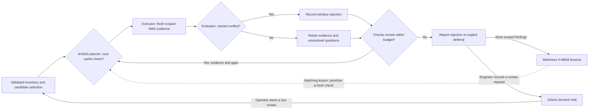
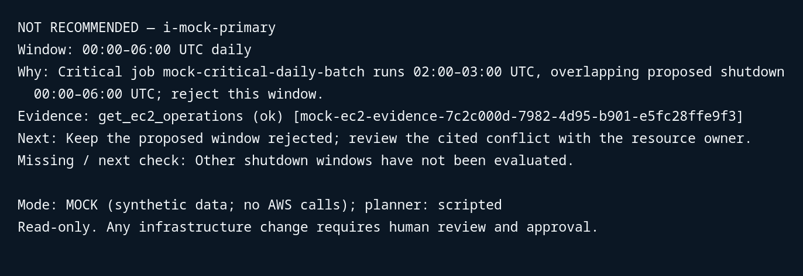

# 01 · Problem and users

## Low CPU can hide a critical overnight job

**Cloud Cost Investigator**

Open Agent Hackathon 2026 · Track 02: The Agent That Can Explain Why

Infrastructure engineers see a quiet EC2 instance and a possible shutdown window.
The reason to keep that window open may be scattered across metrics, job schedules
and service dependencies.

**Their question: “What blocks this shutdown window?”**

CCI investigates the evidence. An authorized human owns any infrastructure change.

---

# 02 · The solution

## A cited rejection, or a concrete next check

Discover up to three EC2 candidates in the engineer's account and region.
Challenge each proposed off-hours window with current operational evidence.

| Result | What the engineer receives |
| --- | --- |
| **Reject this window** | A named job, maintenance interval or dependency obligation, with its conflict and current evidence citation. |
| **Defer the decision** | The specific missing evidence or unresolved human decision, with a concrete next action. |

Complete technical checks do not authorize shutdown. CCI stays read-only and
produces no new savings estimates.

<!-- Speaker notes: No baseline is required. Browser F demonstrates first use with empty history. A demonstrates complete technical evidence with an external human decision still required. Source: docs/PROJECT_CONTEXT.md#6-decision-policy and docs/SCENARIOS.md#browser-coverage-ag. -->

---

# 03 · Agent workflow

## Evidence can change the plan and the conclusion

**Shared state:** retrieved evidence, current hypothesis, prior attempts and remaining budget.
Trusted code validates scope and citations and owns the verdict.

<!-- Speaker notes: Inventory is an automatic prerequisite. Empty inventory succeeds without a model call; exhausted inventory failure stops before planning. Billing ranks validated running resources but is optional. All remaining candidate evidence checks run within the aggregate budget, including after rejection. H-MEM learns only eligible validated findings. Zetaris comparisons are audit context, excluded from model input; the diagram's review edge is operator-initiated, not an autonomous scheduler. Maximum three candidates, 15 minutes total and 60 seconds per model call. Source: docs/components.md and docs/PROJECT_CONTEXT.md. -->

---

# 04 · Technical stack

| Layer | Actual implementation |
| --- | --- |
| Runtime and interface | Node.js 24+, TypeScript CLI, local web UI |
| Current evidence | Read-only AWS SDK: EC2, Cost Explorer, CloudWatch, SSM, ELBv2 |
| Model planning | NVIDIA-hosted Nemotron through a Chat Completions adapter |
| Decision policy | Bounded planner/executor/evaluator loop and runtime-validated reports |
| Decision follow-through | Zetaris scoped history queries and authorized append/readback |
| Investigation lessons | Vendored Meterless H-MEM with local persistence and scoped recall |

**Live proof, Oct 26:** one AWS + NVIDIA investigation reached all five checks,
validated **4/4 citations**, and deferred because evidence was incomplete.

[Sanitized live receipt](docs/evaluation/reject-defer-live-2026-10-26/aws-verification.json)

<!-- Speaker notes: The verified model was nvidia/nemotron-3.5-super-vl-120b-a12b. Six model requests returned HTTP 200 with verified TLS. Zetaris read succeeded with zero applicable records; H-MEM and remote writes were disabled for this run. Native SSM/ELBv2 coverage does not establish all workload jobs, dependencies or authority. This is one verified evidence-gap deferral, not complete operational coverage or repeated reliability. Development-tool attribution is omitted because actual Cursor use is not verified. Sources: docs/evaluation/reject-defer-live-2026-10-26/aws-summary.json and aws-verification.json. -->

---

# 05 · How Zetaris and Meterless were used

## Decisions persist; investigation lessons guide the next check

| Component | Useful contribution | Evidence |
| --- | --- | --- |
| **Zetaris** | Link the investigated result to an attributed review request, due date and later review. Verify saved records by readback. | Real remote append/readback and historical decision/review receipts, using synthetic operational data. |
| **Meterless H-MEM** | Store a scoped conflict lesson, reopen it on a later run, prioritize a fresh check and persist a correction when evidence changes. | Real local cold/warm/changed demonstration: **15/15 checks passed**. |
| **NVIDIA** | Choose the next allowlisted question using the latest retrieved evidence. | Real model calls in fixture evaluations and the separately recorded live AWS deferral. |

**Historical records are not current telemetry.** NVIDIA handles model planning;
H-MEM does not route model calls. Zetaris does not collect the five AWS sources.

[Zetaris receipt](docs/follow-up-zetaris.json) · [Current H-MEM proof](docs/presentation-assets/hmem-proof.json)

<!-- Speaker notes: The dated Zetaris receipt includes legacy acceptance/outcome behavior, not a new-policy remote review demonstration. New results support review requests only. Eligible legacy rollback outcomes can teach H-MEM only through validated links and allowlisted checks; operator prose never becomes planner instructions. The Oct 27 local H-MEM demonstration used synthetic telemetry, scripted planning and disabled Zetaris. Warm ordering changed, but planner-call and tool-call savings were both zero. Do not claim a general speedup. Sources: docs/FOLLOW_UP.md, docs/MEMORY.md and the linked receipts. -->

---

# 06 · What makes the approach distinctive

## A remembered answer must survive a fresh challenge

- **B: disprove an attractive window.** Low CPU suggests 00:00–06:00 UTC. A critical job at 02:00–03:00 UTC rejects it with a current citation.
- **D: expose the gap.** Partial job coverage cannot establish the schedule. Request the owner's authoritative schedule, timezones and exceptions.
- **G: withdraw a stale rejection.** Recheck a remembered dependency conflict. If current evidence no longer supports it, defer the human decision instead of repeating history.

**The learning benefit is a better question to check first. Fresh evidence still controls the answer.**

**Measured limitation:** the Oct 26 current-policy NVIDIA gate passed **7/12 runs**.
All twelve retained reject/defer verdicts; HTTP 500 and invalid-choice failures keep
reliability work open.

[Recorded 12-run gate](docs/evaluation/reject-defer-reliability-network-2026-10-26/summary.json)

<!-- Speaker notes: B/D/G here are browser presets. D uses partial coverage for fast preview selection; unavailable-source/retry behavior is tested separately. G begins with seeded mock history, not an executed preceding run. The separate real local H-MEM demonstration executes cold C, warm C and changed A with reopened persistence. Browser A covers the human-decision boundary, E independent multi-candidate investigation, F empty-history first use. All browser previews use synthetic evidence and a scripted planner. Safe deferral after a failed model run does not count as a reliability pass. Source: docs/SCENARIOS.md and linked evaluation. -->

---

# 07 · Product visuals

## The verdict leads to inspectable evidence and a human task

| Current evidence in this captured run | Meaning |
| --- | --- |
| CPU average **2%**, peak **8%** | Motivates investigation; does not authorize shutdown. |
| `mock-critical-daily-batch`, **02:00–03:00 UTC** | Overlaps the proposed **00:00–06:00 UTC** window and supplies the cited rejection. |
| Dependencies checked after the conflict | The investigation continues collecting remaining evidence within budget. |

**Synthetic/scripted capture.** The image renders actual CLI output, not a browser
screenshot. Both historical stores in this preview are isolated mocks.

[Exact output](docs/presentation-assets/B.txt) · [Validated report and evidence IDs](docs/presentation-assets/B.json)

<!-- Speaker notes: Captured Oct 27 from the actual investigator and report renderer. The image is an unedited excerpt of the captured output with the mode and human-approval boundary retained. Open the report for full source coverage and exact current evidence IDs. The web exposes the same report in Investigate, selected-result context in Learn, and review tasks in Follow through. Trace confidence measures retrieved-check completeness, not probability of safety. Native live coverage is narrower than these synthetic observations. The preview's successful mock history statuses are not sponsor-service receipts. -->

---

# 08 · Future enhancements

## Better evidence and more reliable follow-through

- Connect authoritative workload schedules and named dependency obligations beyond native SSM and ELBv2 coverage.
- Improve planner reliability against the retained HTTP 500 and invalid-choice failures, then repeat the same evaluation gate.
- Add due-review reminders and clearer evidence-gap follow-up while keeping fresh investigation explicit.
- Measure learned check ordering against strong fixed orders, including teaching cost and changed evidence.

**The boundary stays the same:** explain a window-specific rejection or deferral.
Any infrastructure change remains under authorized human control.

<!-- Speaker notes: These are future improvements, not delivered capabilities. No automated shutdown, realized savings or calibrated safety probability is claimed. The current web records review requests; the CLI demonstrates due reviews using explicit synthetic scenarios. Sources: docs/FOLLOW_UP.md and docs/evaluation/README.md. -->
