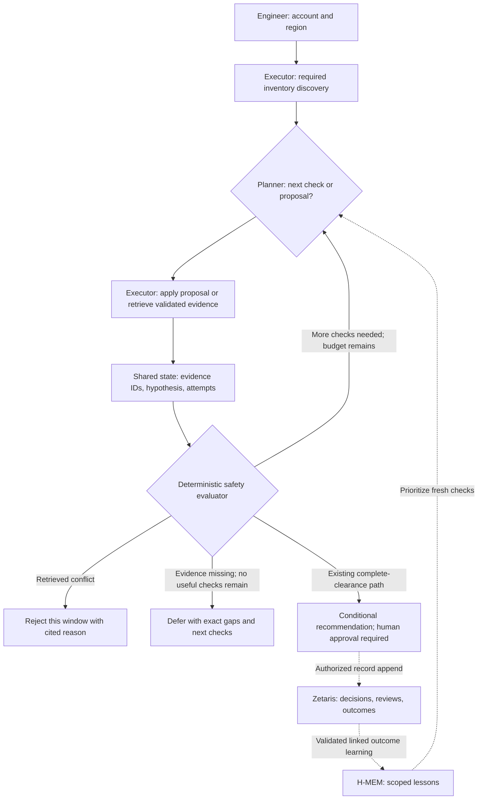

# 01 · Problem and users

## Low CPU does not mean an EC2 instance can stop

**Cloud Cost Investigator** · Open Agent Hackathon 2026\
Track 02 — The Agent That Can Explain Why

**User:** an infrastructure or platform engineer deciding which EC2 instances could stop during off-hours.

Cost, utilization, scheduled jobs and dependencies live in separate places. A quiet instance may still run a critical overnight task.

> Identify a specific reason to reject a shutdown window, or say exactly what evidence is missing and defer the decision.

<details>
<summary>Speaker notes and source</summary>

Lead with the engineer's decision. The MVP investigates EC2 scheduling within a supplied account and region; it does not require a previous investigation. Keep the story focused on a cited conflict or an actionable evidence gap.

[Product and users](docs/PROJECT_CONTEXT.md#1-product-and-user-decision)

</details>

---

# 02 · The solution

## A reason to reject, or the evidence needed to decide

**Discover candidates → propose a window → challenge it with fresh evidence.**

| Outcome | What the engineer receives |
| --- | --- |
| 🔴 Not recommended | A specific window rejected because retrieved evidence contradicts it |
| 🟠 Needs verification | Missing evidence and the next checks needed to decide |

Up to **three candidates per investigation**. The existing complete-clearance synthetic A case remains a broader conditional-recommendation boundary test; it does not demonstrate live clearance.

**AWS access is read-only. Infrastructure changes require an authorized human.**

<details>
<summary>Speaker notes and source</summary>

A rejected window does not establish that an instance must run at all other times. An application decision record is also not authenticated infrastructure approval. Keep these boundaries visible when presenting the positive scenario.

[Decision policy](docs/PROJECT_CONTEXT.md#6-decision-policy)

</details>

---

# 03 · Agent workflow

## One bounded investigation loop



The model selects allowlisted actions. Trusted code binds scope, validates results and controls verdicts.

**Maximum 15 minutes per investigation; 60 seconds per model call.** Failures are traced, retries are bounded, and unresolved safety is deferred.

<details>
<summary>Speaker notes and source</summary>

The runner owns shared state. Planner, executor and evaluator describe responsibilities within one engine; the evaluator is deterministic code. Solid arrows show current investigation flow; dotted arrows show persistence and cross-run learning. Zetaris history is historical context, never fresh telemetry or raw planner instructions. H-MEM recall changes which question is asked first, while every current conclusion still requires new evidence.

[Component authority, shared state and bounds](docs/components.md)

</details>

---

# 04 · Technical stack

## TypeScript engine, direct evidence and separate memory roles

| Layer | Implementation |
| --- | --- |
| Runtime and interface | Node.js 24+, TypeScript CLI, local browser demo |
| Current evidence | AWS SDK: EC2, Cost Explorer, CloudWatch, SSM and ELBv2 |
| Investigation | Planner → executor → deterministic evaluator; runtime-validated reports |
| Model planning | Chat Completions adapter; NVIDIA-hosted Nemotron demonstrated |
| Durable decision trail | Zetaris allowlisted history queries and explicitly enabled append/readback |
| Reusable lessons | Vendored Meterless H-MEM with scoped store/retrieve |

**Development attribution:** Cursor use still requires a factual team account before submission.

<details>
<summary>Speaker notes and sources</summary>

The offline scripted planner exercises the same policy without inference. NVIDIA is one demonstrated real planner provider; a separate repeated OpenAI gate must not be presented as NVIDIA reliability evidence. Credit the inherited notebook and vendored H-MEM reference as reused starter components.

[Stack](package.json) · [Sponsor roles and reused components](docs/components.md#sponsor-technology-explanation)

</details>

---

# 05 · Zetaris, Meterless and NVIDIA

## Decisions become lessons; lessons guide fresh investigation

**Zetaris — follow the decision through**\
Retain investigation history for later comparison. The existing Accept/Defer, review and outcome workflow currently requires a completed conditional recommendation; it does not yet accept rejected or evidence-deferred results. Authorized appends are schema-validated and checked by readback.

**Meterless H-MEM — remember what to investigate**\
Store and retrieve scoped lessons such as “check this workload's dependency first.” A validated, linked rollback outcome can teach a future check priority.

**NVIDIA Nemotron — choose the next question**\
Real model calls select allowlisted checks; the evaluator verifies the evidence before issuing a verdict.

> Decision trail → validated lesson → prioritized check → fresh evidence → revised decision

**Recorded proof:** real remote Zetaris append/readback, local H-MEM persistence and NVIDIA inference over explicitly synthetic operational evidence.

<details>
<summary>Speaker notes and source</summary>

Zetaris provides durable follow-through that current telemetry cannot reconstruct. H-MEM retains investigation methods. NVIDIA planning calls use the configured model endpoint directly; this project does not route every model call through Meterless. Operator-reported outcomes are historical statements, not verified savings or current workload facts.

[Sponsor explanation and linked execution receipts](docs/components.md#sponsor-technology-explanation)

</details>

---

# 06 · What is distinctive

## The agent can disprove its own shutdown proposal

**Scenario B · real NVIDIA planner, synthetic operational evidence**

1. **Propose:** CPU averages **2.1%**, with a **9.3%** peak; investigate **00:00–06:00 UTC**.
2. **Challenge:** retrieve operational evidence before treating the window as safe.
3. **Revise:** a critical finance reconciliation job runs **02:00–03:00 UTC**. Reject this window and cite that observation.

| Eight designed synthetic cases | Correct dispositions | Recommendations on known unsafe cases |
| --- | --- | --- |
| Average-CPU heuristic | 2/8 | 3/3 |
| Investigation with scripted planner | 8/8 | 0/3 |

**Memory result:** across eight workloads, H-MEM tied both fixed check orders at **47 planner / 38 tool calls**. Teaching added **45 / 37** calls if performed solely to seed memory.

<details>
<summary>Speaker notes and sources</summary>

The B trace demonstrates evidence-dependent revision with an actual model. The comparison table is a separate scripted-policy measurement, not a claim about model superiority or production accuracy. The CPU baseline recommends when average CPU is at most 10% and ignores operational checks. The eight-workload memory comparison includes changed and missing evidence; it does not demonstrate a general speedup. Changed-evidence demonstrations show that fresh clearance can overturn a recalled blocker.

[B model report](docs/evaluation/trace-readable-2026-10-26/B.json) · [Safety comparison](docs/evaluation-scripted.json) · [Memory comparison and teaching cost](docs/memory-order-evaluation.json)

</details>

---

# 07 · Product output

## Verdict first, evidence one step away

**Actual CLI excerpt · offline B run · synthetic evidence / scripted planner**

```text
NOT RECOMMENDED — i-mock-primary
Window: 00:00–06:00 UTC daily
Why: A retrieved critical job overlaps the proposed shutdown window; reject this window.
Next: Keep the proposed window rejected; review the cited conflict with the resource owner.
Savings: unknown
```

**Evidence panel · separate recorded NVIDIA B run · synthetic evidence**

| Check | Finding | Status |
| --- | --- | --- |
| Metrics | 2.1% average / 9.3% peak CPU | Retrieved |
| Operations | Critical job overlaps 02:00–03:00 UTC | Contradicts window |
| Dependencies | Not queried | Unresolved |

**Coverage: 4/5 checks (80%)** in that recorded trace. Completeness is not the probability that shutdown is safe.

The browser exposes **Investigate · Learn · Follow through**. Demo previews are synthetic; learning and follow-through are illustrations. Live operations and separately captured sponsor proofs remain clearly labeled.

<details>
<summary>Speaker notes and sources</summary>

This excerpt was generated with histories disabled using:

```bash
ZETARIS_HISTORY_TABLE= ZETARIS_HISTORY_ALLOW_APPEND=false HMEM_PERSIST_DIR= npm run --silent investigate -- --evidence mock --planner scripted --account demo --region us-east-1 --lookback-days 7 --scenario B
```

The full output also labels MOCK mode, scope, observation window, stop reason and human approval. Use `--verbose` for evidence IDs and the full trace. The evidence panel comes from the separate recorded model run used on slide 6: metrics ID `mock-ec2-evidence-9e4452bd-7096-4eb7-a40a-0d34e96b7f3d`, conflicting operations ID `mock-ec2-evidence-8eec416f-ba04-43a5-b5b8-c75ab98c8ff7`. Its final JSONL coverage is 0.8. The JSONL confidence field counts complete authoritative checks already retrieved for this candidate divided by five required checks; it never determines the verdict. A decisive conflict can reject a window before every check finishes. The CLI excerpt is a product visual, not a browser screenshot or live AWS result.

[CLI and trace interpretation](docs/CLI_GUIDE.md) · [Recorded B evidence](docs/evaluation/trace-readable-2026-10-26/B.json) · [Coverage trace](docs/evaluation/trace-readable-2026-10-26/B.trace.jsonl) · [Browser demo](docs/HOW.md#open-the-web-demo)

</details>

---

# 08 · Future enhancements

## Make conflicts more specific and evidence gaps actionable

**Next: complete operational evidence**\
Identify named jobs and dependency obligations, preserve their time windows and coverage, and explain precisely which sources are still missing.

**Then: stronger decision follow-through**\
Support review of rejected windows and resolution of evidence gaps, with fresh investigations before reassessment.

**Then: measure explanation quality and learning**\
Verify named conflicts, exact missing evidence and useful next checks. Compare learned check order with strong fixed baselines, including teaching cost and changed evidence.

**Current live boundary:** AWS retrieval is demonstrated; incomplete telemetry and operational authority still defer scheduling advice. Live savings remain unknown.

> Every result should make the conflict or the missing evidence understandable without reading raw tool output.

<details>
<summary>Speaker notes and sources</summary>

These enhancements are future work. The latest integrated live CLI run retrieved inventory and partial billing/metrics, then deferred with `metrics_evidence_incomplete`; it did not reach operational/dependency checks. Separate source-access tests do not establish combined scheduling safety. Release still requires the reviewed demo recording, final artifact review, accurate development-tool attribution and organizer/portal reconciliation. This Markdown deck does not establish completed submission.

[Live execution receipt](docs/history/aws-investigation-2026-10-26.json) · [Release gates](docs/EXECUTION_PLAN.md#release-checklist)

</details>
