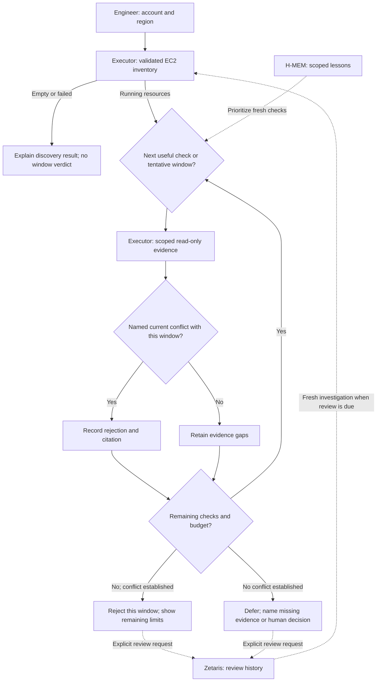

# 01 · Problem and users

## Low CPU does not tell an engineer whether a shutdown window is safe

**Cloud Cost Investigator** · Open Agent Hackathon 2026
**Track 02 — The Agent That Can Explain Why**

An infrastructure engineer sees a quiet EC2 instance. A scheduled job or dependent service may still need it during the proposed off-hours window.

> Identify a specific reason to reject a shutdown window, or say exactly what evidence is missing and defer the decision.

CCI is read-only. The authorized human change process owns shutdown decisions.

---

# 02 · The solution

## A cited conflict, or an actionable evidence gap

| Result                 | What the engineer receives                                                                                           |
| ---------------------- | -------------------------------------------------------------------------------------------------------------------- |
| **Reject this window** | The named job, maintenance execution or dependency obligation; its conflict with this window; a current-run citation |
| **Defer the decision** | Missing source, coverage, authority or external human decision; the next check needed                                |

**No conflict found does not mean approved.** Even complete technical checks leave the authorized shutdown decision outside CCI.

New runs produce no conditional recommendations or savings. Historical reports remain readable under their original validation rules.

---

# 03 · Agent workflow

## One bounded loop, with explicit decisions



The model chooses allowlisted questions. Trusted code binds scope, validates evidence and owns verdicts. Inventory is mandatory; billing ranks candidates but cannot block operational checks. Both operational checks are attempted within the shared budget, even after a conflict.

**Bounds:** at most three candidates, 15 minutes total, 60 seconds per model call. Missing evidence remains unknown; completed findings survive exhaustion.

---

# 04 · Technical stack and live limits

| Layer               | Implementation                                                  |
| ------------------- | --------------------------------------------------------------- |
| Runtime / interface | Node.js 24+, TypeScript CLI and local web UI                    |
| Current evidence    | Read-only AWS SDK: EC2, Cost Explorer, CloudWatch, SSM, ELBv2   |
| Decision engine     | Planner → executor → deterministic evaluator; validated reports |
| Planning            | Chat Completions adapter; NVIDIA-hosted Nemotron demonstrated   |
| History             | Zetaris allowlisted queries and acknowledged append/readback    |
| Lessons             | Vendored Meterless H-MEM, scoped local store/retrieve           |

**Native live coverage:** dated SSM maintenance can establish an overlap. ELBv2 registration alone cannot establish a continuous-operation obligation. Jobs and dependencies outside those sources remain unknown. Synthetic examples do not prove broader live integrations.

[Architecture and proof boundaries](docs/components.md)

---

# 05 · Sponsor contributions

## History preserves the question; fresh evidence decides the answer

**Zetaris:** retain rejected or deferred investigations and attributed review requests. Due reviews require fresh scoped evidence. Historical accepted recommendations and outcome records remain compatible; new runs never grant acceptance.

**Meterless H-MEM:** store and retrieve scoped lessons about useful checks. Recall can change check order; a previous rejection cannot replace today's evidence. Measure against fixed orders and include teaching cost.

**NVIDIA Nemotron:** choose the next allowlisted question. The evaluator, not the model, controls the result. NVIDIA calls use the configured endpoint directly; H-MEM is not the model runtime.

Separate recorded receipts demonstrate real sponsor calls over **synthetic AWS evidence**. They do not prove the newly changed workflow against remote services or production shutdown safety. [Sponsor receipts](docs/components.md#sponsor-technology-explanation)

---

# 06 · Demonstrate both useful answers

1. **B — named conflict:** synthetic `mock-critical-daily-batch` runs **02:00–03:00 UTC**, overlapping proposed **00:00–06:00 UTC**. Reject that window and cite the job observation.
2. **Missing evidence:** operations are unavailable. Defer; request an authoritative job schedule with timezones and exceptions. Other available checks still run.
3. **Changed evidence:** a previous dependency conflict is no longer observed. Recheck the other sources and defer any outstanding decision; never repeat the stale rejection or infer approval.

A is the boundary case: complete synthetic technical evidence, no found conflict, external human decision still required.

The scenario suite proves policy and explanation behavior with labeled fixtures. Historical model measurements remain historical; rerun an explicitly authorized model gate to measure the current contract.

---

# 07 · Product output

## Put the reason and next check in the default view

Illustrative projection of the actual B fixture, with varying citation IDs omitted:

```text
NOT RECOMMENDED — i-mock-primary
Window: 00:00–06:00 UTC daily
Why: Critical job mock-critical-daily-batch runs 02:00–03:00 UTC,
     overlapping proposed shutdown 00:00–06:00 UTC; reject this window.
Next: Review the cited conflict with the resource owner.
```

For a deferral, the CLI and result card show the missing checks directly. Raw evidence and full trace remain expandable. Trace coverage describes collected evidence, never a probability of safety.

**Demo** is preview-only across Investigate, Learn and Follow through. **Live** runs configured services and separately acknowledged review recording. No scenario is selected automatically.

[Scenario reproduction](docs/SCENARIOS.md) · [Trace reference](docs/CLI_GUIDE.md)

---

# 08 · Next improvements and honest boundaries

- Extend authoritative live job and named dependency coverage.
- Resolve evidence gaps through fresh reviews, while preserving attribution and provenance.
- Evaluate named reasons, exact missing evidence and useful next checks; compare learned check order with strong fixed baselines.

No infrastructure writes, automated shutdown, multi-cloud expansion or invented savings are needed to deliver this purpose.

Historical traces and sponsor receipts are preserved. This deck is not a recorded demo or a completed submission. Cursor attribution and organizer requirements still require factual team verification; current release gates live in [the execution plan](docs/EXECUTION_PLAN.md).
